<div align="center">

# Noema

**A local-first workspace for notes, docs and databases.**

An original, open-source, self-hosted alternative to Notion — for teams and
individuals. Everything is a page: documents, folders and database rows share
one model. It runs on your machine, it is yours to extend, and it also ships as
a desktop app that needs nothing else installed.

<!-- Every link points at the canonical repository, https://github.com/Guembri01/noema.
     `src/lib/project-info.ts` holds the URL the app uses; keep the two in step. -->

[](./LICENSE)
[](https://github.com/Guembri01/noema/actions/workflows/ci.yml)
[](https://nextjs.org)
[](./.nvmrc)
[](./CONTRIBUTING.md)

[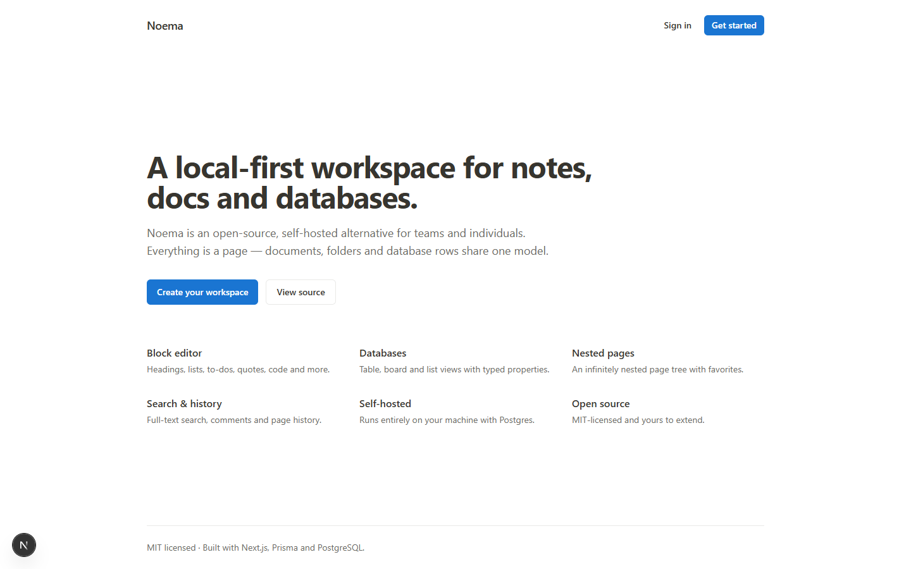](./docs/screenshots/01-landing.png)

</div>

> **Notion is a trademark of its respective owner.** Noema is not affiliated
> with, endorsed by, or derived from Notion's source code, assets or
> trademarks. It implements the same *category* of product from publicly
> documented behaviour only. See [Notice](#notice).

- **Stack:** Next.js 15 (App Router) · React 19 · TypeScript · Tailwind CSS v4 · Prisma 6 · PostgreSQL (docker container `noema-db`, port **5433**) · TipTap · Tauri 2 for the desktop app
- **Runs locally:** one `docker compose up` for the database, one `npm run dev` for the app.
- **Runs as an app:** one installer — no Postgres, no Docker, no account. See [Desktop app](#desktop-app).
- **License:** MIT · **Built by** [Bilel Guembri and Wissal Ben Othmen](#authors)

---

## Contents

| Start here | Go deeper |
| --- | --- |
| [Status](#status) — what this repository is today | [Architecture](#architecture) — how it is put together |
| [Implemented today](#implemented-today) — what works, area by area | [Project layout](#project-layout) — where the files live |
| [Desktop app](#desktop-app) — the installable build | [Scripts](#scripts) — every gate and check |
| [Quick start](#quick-start) — Docker, `.env`, `npm run dev` | [Where to read next](#where-to-read-next) — the full docs set |
| [Demo](#demo) — the two-minute product film | [Contributing](#contributing) · [Security](#security) |
| [Screenshots](#screenshots) — the interface at a glance | [Authors](#authors) · [License](#license) |

## Demo

[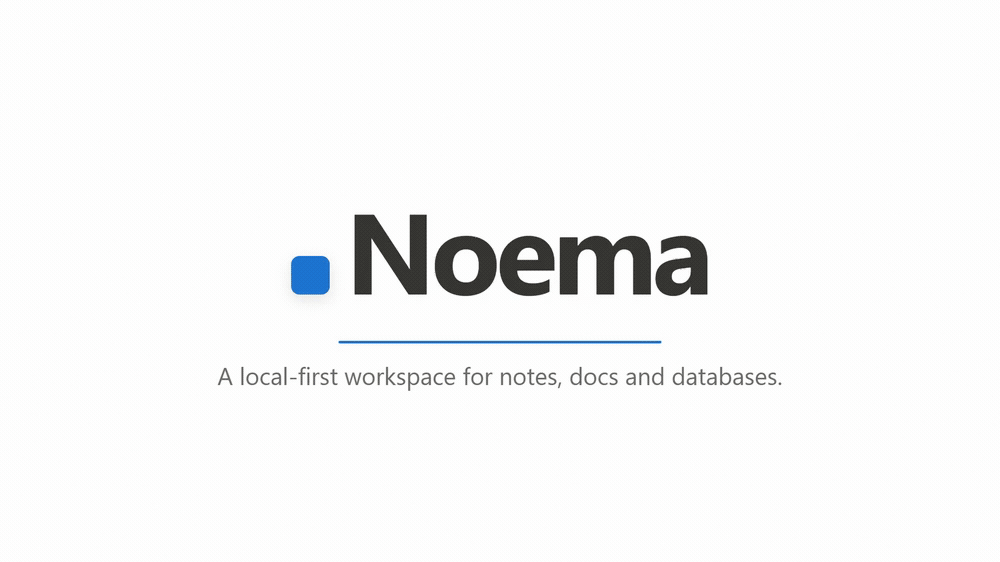](https://github.com/Guembri01/noema/releases/latest/download/Noema-demo.mp4)

**[▶ Watch the two-minute product film](https://github.com/Guembri01/noema/releases/latest/download/Noema-demo.mp4)** — one pass over
every area: the block editor, seven database views, conditional formatting,
tickets with labels and estimates, cycles and burndown, projects and milestones,
the workspace roadmap, grounded chat, comments, version history, sharing and the
desktop build.

The film is not a screen recording: every frame is composed from captured
screenshots of the running app, so it is reproducible. The project lives in
[`video/`](./video/README.md) — `npm install && npm run render`.

## Status

This repository is a **working application plus a complete parity tracker**.

- The app runs and implements the core workspace loop (auth → workspaces →
  nested pages → block editor → databases → search → comments → history) and
  well beyond it: tickets, projects and cycles, workspace chat, AI, sharing and
  SSO, signed webhooks, and the desktop build.
- Every feature area is tracked in **[`docs/FEATURE_MATRIX.md`](./docs/FEATURE_MATRIX.md)**
  — 563 rows, each with a status and a note explaining the current state. Today:
  **454 implemented · 87 partial · 0 planned · 22 deliberately out of scope**.
- Nothing is dropped silently. What is unfinished is enumerated in
  **[`docs/MISSING_FEATURES.md`](./docs/MISSING_FEATURES.md)**, generated from the
  matrix by `npm run docs:gaps`, so the two cannot disagree.

## Implemented today

| Area | What works |
| --- | --- |
| Auth | Email + password signup/login/logout, hashed passwords (bcrypt), signed JWT session cookie |
| Workspaces | Create workspaces, memberships + roles (OWNER/ADMIN/MEMBER/GUEST), multi-workspace switcher |
| Pages | Infinitely nested page tree, icons, favorites, soft-delete/trash, version snapshots |
| Editor | TipTap block editor: headings, lists, to-do lists, quote, code, divider, **callout**, **toggle**, **columns**, **table**, **table of contents**, **inline + block equations (KaTeX)**, **breadcrumb**, **bookmark & embed** (YouTube/Vimeo/Loom/Spotify/Figma…), **synced view** (page transclusion), **@-mentions** (pages/people/dates), **file & image uploads** (paste, drag-drop or picker), rich inline formatting via a **selection bubble menu**, a keyboard-driven `/` slash menu, and **pointer drag-and-drop** reordering |
| Link previews | `GET /api/link-preview` fetches OpenGraph metadata with an SSRF guard (http(s) only, DNS-resolved hosts and every redirect hop must be public), size cap and timeout |
| Backlinks | **Linked references** — pages that @-mention the current page |
| Databases | Full-page databases with typed properties, **Table / Board / List / Gallery / Calendar / Timeline / Chart** views, **AND/OR + nested filters, sorts, grouping, conditional colors** (saved per view), view tabs with an “add view” menu, per-property menus (rename/duplicate/delete/formula), inline cell editing, templates, CSV import/export, open-row-as-page |
| Page chrome | Emoji icons, cover images (presets), breadcrumbs, page options menu (copy link, cover, export, move to workspace, lock, trash), favorites, **follow** |
| Navigation | **Row side-peek**, **responsive mobile shell** (drawer sidebar), ⌘K quick find, breadcrumbs, following/favorites |
| Properties | TEXT, NUMBER, SELECT, MULTI_SELECT, STATUS, DATE, CHECKBOX, URL/EMAIL/PHONE, PEOPLE, FILES, **FORMULA** (expression engine), **RELATION** (link to another database), **ROLLUP** (14 aggregates over related rows), and computed system fields (**CREATED_TIME/BY, LAST_EDITED_TIME/BY, UNIQUE_ID**) |
| Search | Full-text search across page titles and body content |
| Comments | Page comments, threaded replies, resolve, delete, notifications on reply |
| UX | **Notion-white default theme** (light) with a dark toggle, **⌘K quick-find command palette**, toast notifications, tooltips, responsive sidebar, accessible primitives (Radix) |
| Page settings | Full-width, small text and font (default/serif/mono), saved per page |
| Import / Export | Export a page as **Markdown / JSON / HTML**, a database as **CSV**, the whole workspace as a **.zip**; import **Markdown** or **CSV** |
| Sharing | **Share to web** — publish a page read-only at `/s/<token>` with optional **password + expiry**; unpublish; per-member share levels and **email invitations** (see [Permissions](#permissions-guests-teamspaces-page-shares)) |
| Templates | **Template button** block + database templates with **recurrence** (daily/weekly/monthly) materialized by `POST /api/cron/templates` |
| Public API | `GET/POST /api/v1/pages`, `GET /api/v1/pages/:id`, `GET /api/v1/search`, `GET /api/v1/workspaces` — authenticated with **Bearer API tokens** (hashed at rest, managed in workspace settings); the token's **scope grant is enforced** (`read:pages` for the read routes, `write:pages` for creating pages) |
| Workspace settings | Rename, member list, API tokens, workspace export |
| Home & templates | A greeting home with **Empty page / Empty database** cards, a **workflow template gallery** (Task tracking, Projects, Skills, Document center, Brainstorm, Meeting notes) with mini previews, and “Other templates”; `POST /api/templates` |
| Sidebar chrome | **Home / Chat / Meetings** tabs, **Projects**, **Library**, **Teamspaces**, **Private pages**, search, **Add**, **Customize**, a footer help menu, and a **right-click menu on every page** (open, open in new tab, discuss in chat, rename, favorite, copy link, move to teamspace/project, trash) |
| Library | `/w/<slug>/library` — every database and page in one browsable grid |
| Discussions | **Workspace chat**: draft-first threads (no empty rows — the thread is created on the first message), first message names it, notes can be pinned to a discussion, and `/ask …` gets a grounded AI answer; `GET/POST /api/chat` |
| Meetings | **Calendar subscriptions** — paste an ICS URL, events are imported/refreshed, and one click turns an event into a **meeting-notes page**; `GET/POST /api/calendar` |
| Version history | **Slide-over panel** (no longer a long list in the page body): who changed what, relative time, character delta, “Renamed to …”, and one-click **Restore** |
| Block menu | **Right-click any block**: Turn into, Colour, **Ask AI**, **Move up/down**, Duplicate, Comment, Copy link, **Edit equation**, Delete — plus a Notion-style caret and selection colour |
| AI skills | Selection-toolbar **Ask AI**: Improve writing, Proofread, Reformat, Make shorter, Explain, Summarize, Translate |
| Undo / redo | Floating undo/redo controls in the editor |
| Inbox | Notification inbox with unread badge and “mark all read” |
| Realtime | **Optional Yjs collaboration** (`npm run collab` + `NEXT_PUBLIC_COLLAB_URL`) with awareness/live cursors and a “Live · N” indicator |
| Webhooks | **HMAC-SHA256-signed** POST deliveries on `page.created`, `page.updated`, `row.created`, `comment.created`; managed in workspace settings |
| AI | `POST /api/ai` (OpenAI-compatible: OpenAI, **DeepSeek**, Groq, Ollama…) + an **Ask AI** block (ask + summarize) + a database **AI autofill** property + **AI skills** (`POST /api/ai/skills`); degrades to 503 guidance when unconfigured |
| AI grounding | Ask answers are grounded in your workspace: prompts are reduced to keywords and pages scored by relevance (`src/lib/retrieval.ts`) |
| Webhook log | Delivery outcomes recorded (`WebhookDelivery`) with **retries** (3 attempts, backoff), status/attempts/error shown in settings |
| Exports | … plus **PDF** (via `pdfkit`) |
| Database templates | Save any row as a template; create rows from templates |
| i18n / RTL | 5 locales (en/fr/es/de/ar) with correct `lang`/`dir`, translated core navigation, and a language switcher |
| Security | bcrypt passwords, HS256 JWT session cookies, **2FA (TOTP)** with any authenticator app, API tokens hashed at rest, **fixed-window rate limiting** on every API route |
| OAuth apps | Register an app in settings; **authorization-code flow** (`/oauth/authorize` → `/oauth/token`) issues Bearer API tokens |
| Page permissions | Per-member page access (**Can edit / Can view / No access**) that overrides the workspace role for that page |
| Automations | **Button properties** (set another property to a value on click) and **page locking** (read-only pages/databases) |
| Importers | **Trello JSON** → database (lists → status options), **Markdown .zip** → nested pages, **Word .docx** → page, Markdown file, **Notion API** (`POST /api/import/notion` — integration token + nested child pages) |
| Editor blocks | … + **linked database** (embedded read-only view of another database) |
| Accessibility | Visible focus rings, a **skip-to-content** link, `lang`/`dir` from locale, labelled landmarks/navs/controls, and a **WCAG contrast-audited palette** (`npm run check:a11y`) |
| Formulas | FORMULA properties with an expression engine (`prop("Name")`, `+ - * / %`, comparisons, `if`, `concat`, `round`, `min/max`, `abs`, `length`, `upper/lower`, `contains`, `empty`, `now/today`) |
| Quality | **Vitest** unit tests for the pure logic (block serialisation, database query engine), **Playwright** e2e, `tsc --noEmit`, ESLint, `npm run check:fast` inner-loop gate and `npm run check:coherence` drift gate |

Everything not yet implemented is enumerated in the feature matrix with a
🧭 Planned status.

## Desktop app

The same codebase also builds into a per-user Windows installer: a **Tauri 2**
shell around a **bundled Node runtime** and an **embedded PostgreSQL (PGlite)**.
It needs nothing else on the machine — no Docker, no external database, no
account.

| | |
| --- | --- |
| **Install** | The NSIS installer (`Noema_1.4.1_x64-setup.exe`) installs per user into `%LOCALAPPDATA%\Noema`, and uninstalls from Add/Remove programs. WebView2 is bootstrapped by the installer itself |
| **Your data** | `%APPDATA%\app.noema.desktop` — the database, uploads, the session secret and preferences. Uninstalling keeps it unless you tick *delete application data* |
| **Build it** | `npm run desktop:bundle` → `src-tauri/target/release/bundle/{nsis,msi}` |
| **How it boots** | The shell starts the bundled server on a free loopback port and opens the window on it. The port is a preference, not a contract: it survives a port change because nothing outside the shell depends on the number |
| **One codebase** | The desktop build is the site build with `NOEMA_STANDALONE=1` — the embedded database replaces Postgres and the shell owns the lifecycle. Nothing is forked |

Packaging, security posture and the install verification harness are documented
in [`docs/DESKTOP.md`](./docs/DESKTOP.md).

## Screenshots

Every screen is captured from the seeded demo workspace by
[`scripts/screenshots.mjs`](./scripts/screenshots.mjs) — generated, not
hand-taken, so a surface that changes takes its screenshot with it. The full set
of 44, with captions, is in [`docs/GALLERY.md`](./docs/GALLERY.md).

The same shots are laid out beside the feature list in
**[`docs/Noema-features.pdf`](./docs/Noema-features.pdf)** — a printable feature
sheet, built by `npm run features:pdf` from the README's own feature tables and
the screenshot report, so the document cannot drift from the product either.

| Workspace home | The block editor |
| --- | --- |
| 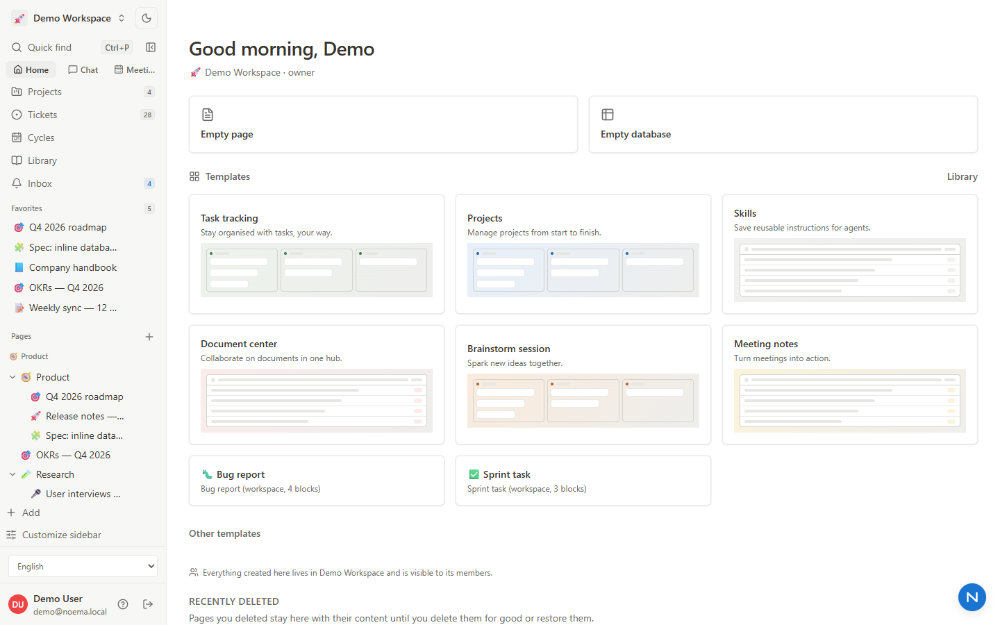 | 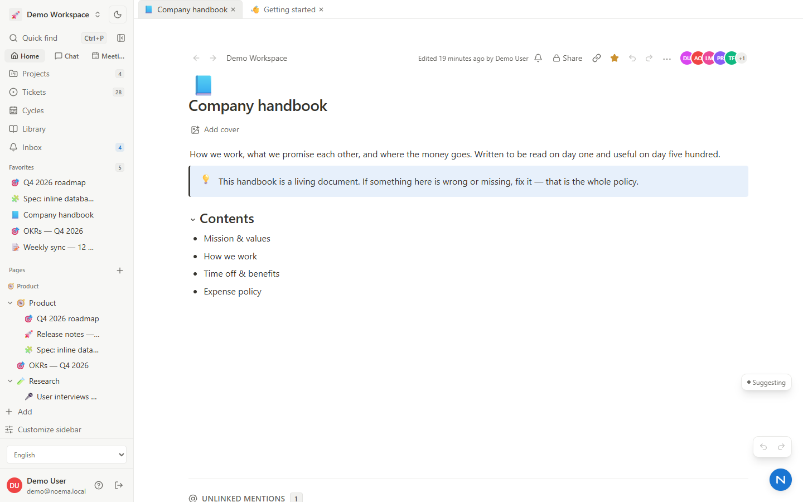 |

| A database — table view | The same rows as a board |
| --- | --- |
| 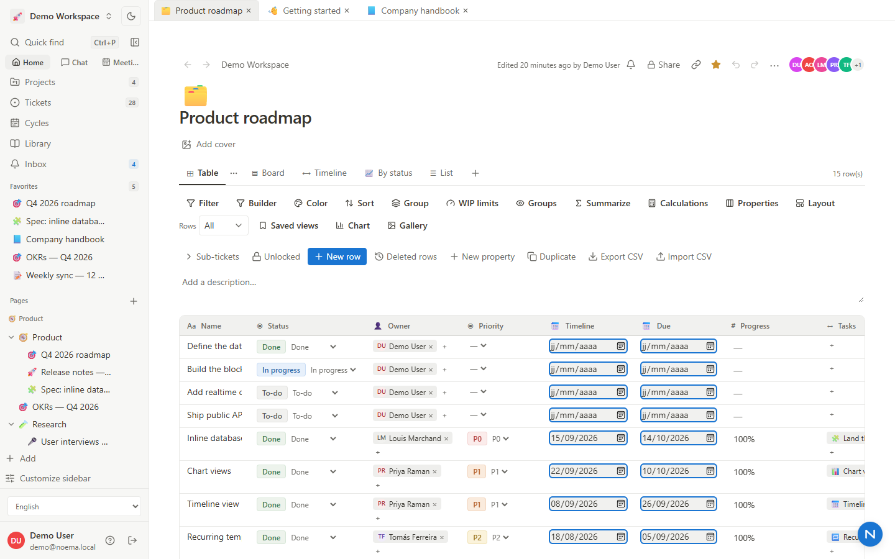 | 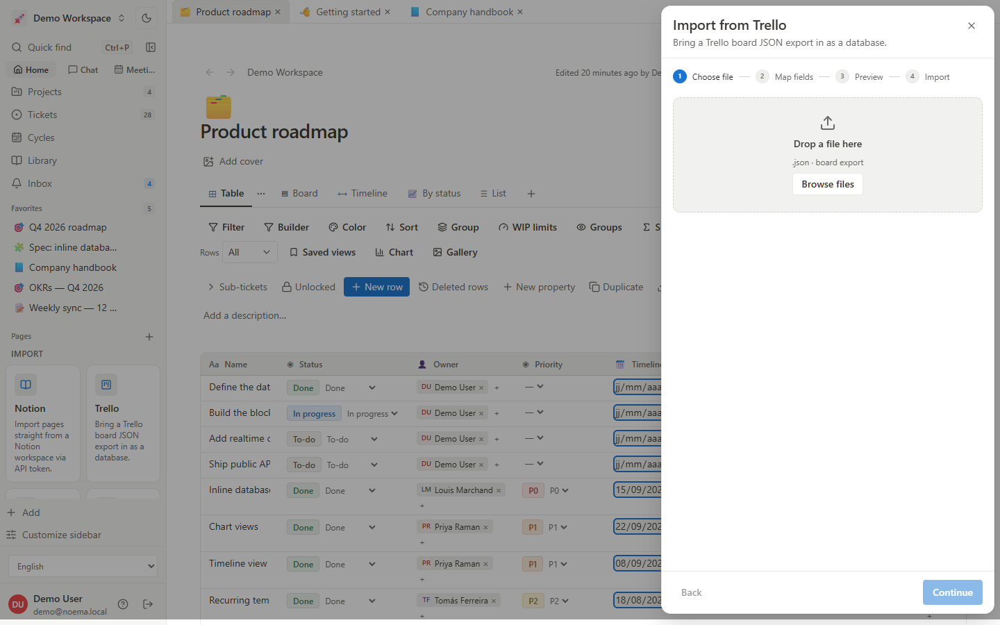 |

| Tickets | Cycles — burndown and scope |
| --- | --- |
|  | 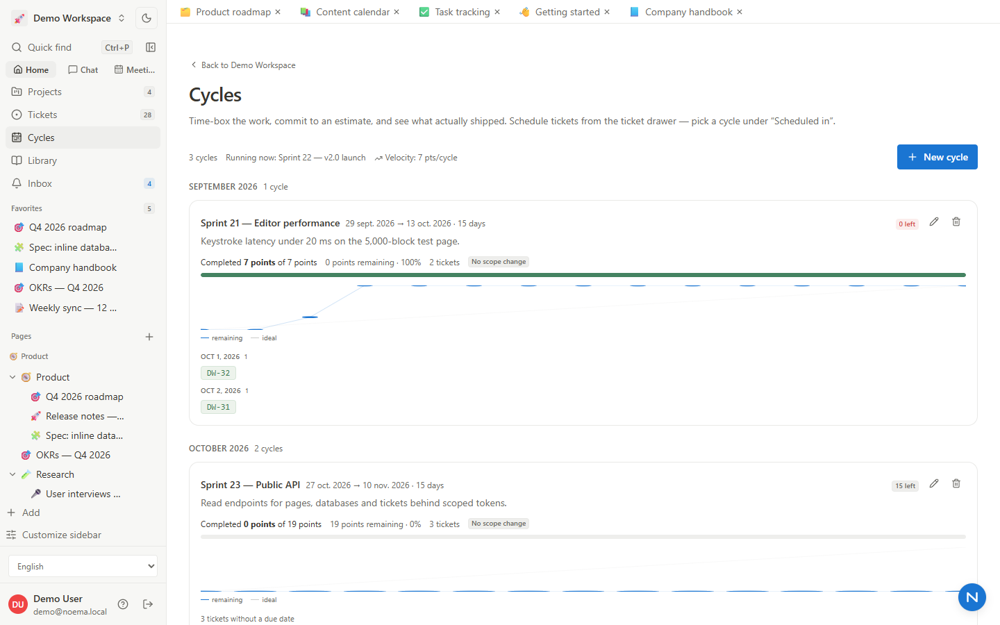 |

| Chat, with the notes it cites | Settings |
| --- | --- |
| 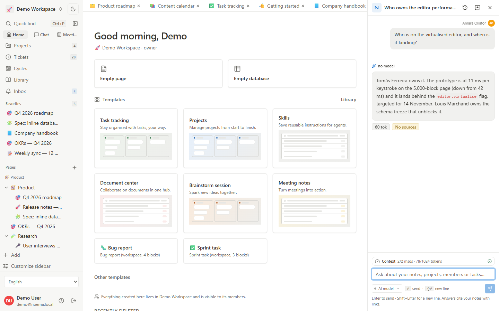 | 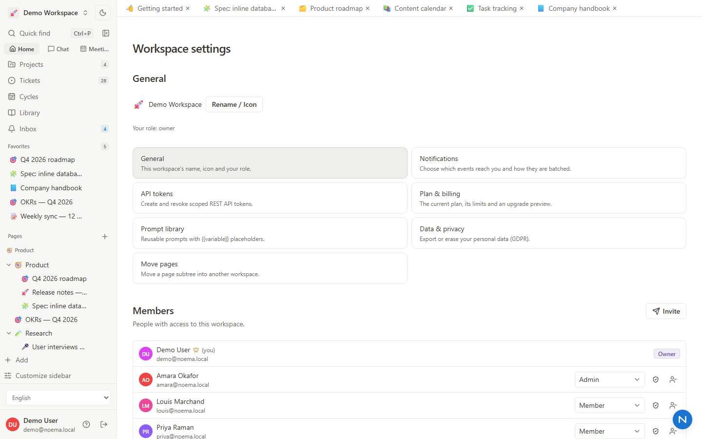 |

| Dark mode | About — version, credits and licence |
| --- | --- |
| 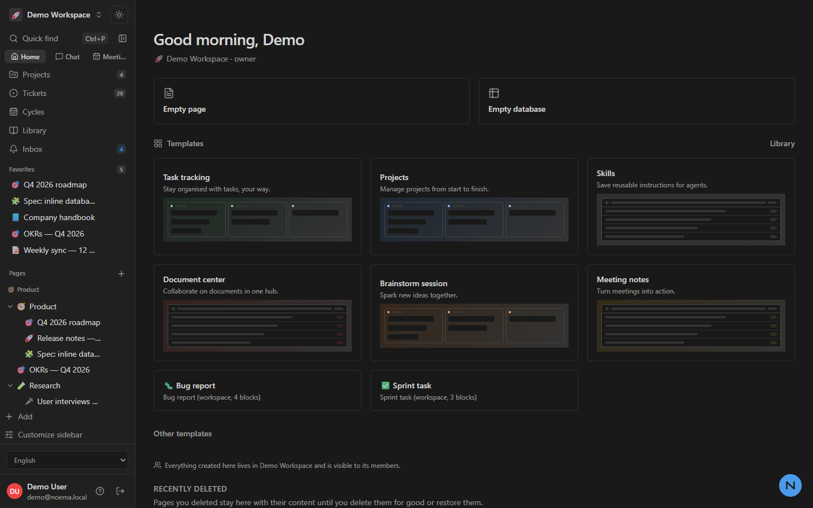 | 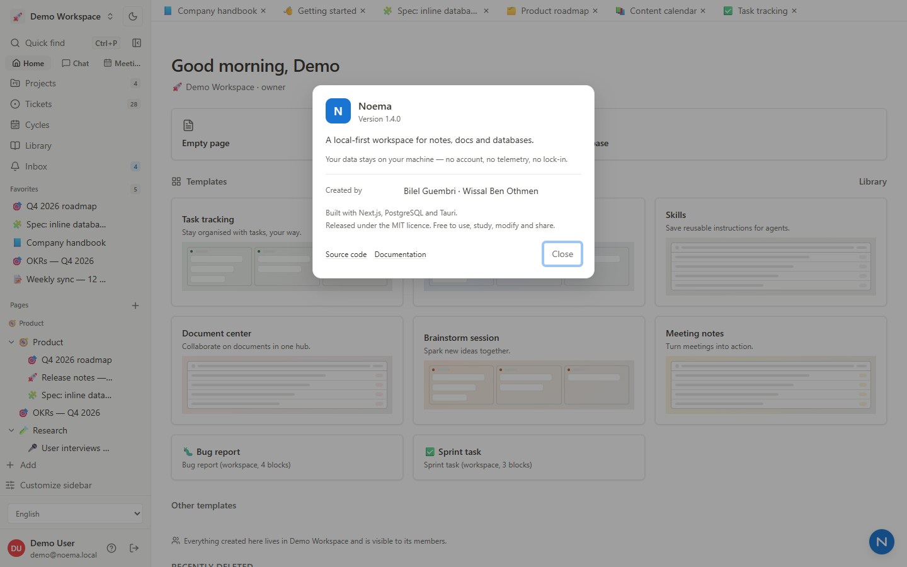 |

The landing page sits at the top of this file. The rest of the interface —
search, databases, tickets, chat, the editor, sharing — is specified in
[`docs/specs/`](./docs/specs/) and tracked row by row in
[`docs/FEATURE_MATRIX.md`](./docs/FEATURE_MATRIX.md).

## AI configuration

Any OpenAI-compatible provider works. Example (DeepSeek):

```bash
AI_API_KEY="sk-…"
AI_BASE_URL="https://api.deepseek.com"
AI_MODEL="deepseek-flash"
```

| Surface | Route | Notes |
| --- | --- | --- |
| Ask / grounded ask | `POST /api/ai` | `{ prompt, workspaceId? }` — the workspace is searched with keyword extraction + relevance scoring, so answers are grounded in your pages |
| Summarize | `POST /api/ai` | `{ mode: "summarize", context }` |
| AI autofill (database) | `POST /api/ai` | `{ mode: "autofill", prompt }` — single value, capped tokens |
| Editor skills | `POST /api/ai/skills` | `{ skillId, text }` → `{ text, replacesSelection }`; prompts live in `src/lib/ai-skills.ts` |
| Speech-to-text | `POST /api/ai/transcribe` | Needs its own key: `AI_TRANSCRIBE_API_KEY` (+ optional `AI_TRANSCRIBE_BASE_URL`, `AI_TRANSCRIBE_MODEL`) because not every chat provider offers audio |

Transport is centralised in `src/lib/ai-provider.ts` (one place for base URL, model, timeouts and error mapping).

## Troubleshooting

**Clicks do nothing / “Saving…” never finishes / comments and chat appear dead.**
These are all *Server Action* failures — the UI can't tell you, it just waits. Two known causes:

1. **Origin mismatch.** Next.js only accepts a Server Action when the request's `Origin` matches the `Host`. If you reach the app through a hostname it doesn't know (a LAN IP after a rebuild, `127.0.0.1` vs `localhost`, or a reverse proxy/tunnel), every action is aborted. Noema allow-lists loopback, this machine's LAN addresses and the usual ports automatically; add anything else (proxy, tunnel) with `APP_ORIGINS`, then restart:
   ```bash
   APP_ORIGINS="noema.example.com,my-tunnel.ngrok.app"
   ```
2. **Stale tab after a rebuild.** A browser tab left open across `npm run build` still holds the previous build's action ids, so every action fails. **Hard-reload (Ctrl+Shift+R)** after a rebuild.

Diagnostics: `npm run check:routes` prints a Server Action origin matrix (same origin / loopback / LAN must pass, foreign origins must be rejected). Any residual failure now raises a toast (`ActionErrorGuard`) instead of hanging.

**The editor's selection menus (colour, highlight, Ask AI).** These render as a panel pinned under the toolbar, measured at click time — they used to be portalled popovers that lost their trigger and appeared in the top-left corner. Escape or a click elsewhere dismisses them.

## Permissions: guests, teamspaces, page shares

| Capability | Detail |
| --- | --- |
| Roles | Owner · admin · member · **guest** — enforced on the server, never only in the UI |
| **Guest page-scoping** | A guest opens **only** the pages shared with them: an explicit `PagePermission`, a page in a teamspace they belong to, or a page they created — plus ancestors so the tree still renders. Applied to the sidebar tree, search and **the page route** (a direct URL to an unshared page is a 404, not a leak). Guests cannot edit, invite or upload |
| Teamspaces | Members see and search only their teamspaces; invites are emailed |
| Page shares | Per-member levels (inherit · view · comment · edit · full) and public links with an optional password and expiry 

Storage & backups

| Capability | Detail |
| --- | --- |
| **Storage driver** | `src/lib/storage.ts` defines one interface with two drivers: **local filesystem** (default, `STORAGE_DIR` or `./uploads`) and **S3-compatible** (AWS, MinIO, Cloudflare R2, Garage) — selected by setting `S3_BUCKET` (+ `S3_ENDPOINT`, `S3_REGION`, `S3_ACCESS_KEY_ID`, `S3_SECRET_ACCESS_KEY`, optional `S3_PREFIX`) |
| **No SDK** | The S3 driver signs requests with **Signature V4** (`signS3Request`, unit-tested for determinism, key encoding and presigned GETs) over `fetch` |
| **Authorised reads** | Files are never public: `/api/files/<workspace>/<name>` re-checks the session, the workspace membership and the caller's role (a guest is refused with `403`), validates the key (no traversal) and streams from whichever driver holds the bytes |
| **Uploads** | Type allow-list + 10 MB cap + `Asset` row; `npm run check:storage` asserts the byte-for-byte round trip, the content type, the 404 for a missing key, the traversal refusal, the anonymous refusal and the 415 for a bad type |
| **Backups** | `npm run backup` writes `backups/noema-<timestamp>.sql.enc` (via the database container or a local `pg_dump`), **sealed with AES-256-GCM** under `BACKUP_ENCRYPTION_KEY` and with mode `0600` (the script fails closed — without a passphrase it writes no dump at all), refuses to keep a suspiciously small file, verifies the core tables are in the dump, keeps the newest 5 and prints the restore command (`npm run backup:restore -- backups/<file>.sql.enc \| psql "$DATABASE_URL"`)

Cycles (sprints)

`/w/<slug>/cycles` turns estimates into a plan:

| Capability | Detail |
| --- | --- |
| **Create a cycle** | Name, start/end dates and an optional goal (in the same dialog pattern as every other create flow; validated on the server) |
| **Schedule work** | The ticket drawer has a **Scheduled in** selector; tickets keep their project, labels and assignee |
| **Commitment** | Each cycle shows completed vs committed estimate, remaining points and a percentage, with a progress bar |
| **Burndown** | Daily remaining points against the ideal straight line, drawn inline (SVG), out of the maths in `src/lib/cycles.ts` |
| **Velocity** | The average completed estimate over the last six finished cycles, shown in the header |
| Delete | Deleting a cycle unschedules its tickets — it never deletes them 

Collaboration depth

| Capability | Detail |
| --- | --- |
| Comments | Anchored to a text selection (the quote is stored and shown), one level of replies, **resolve/reopen**, and delete for your own |
| **Reactions** | 👍🎉❤️😄🙌👀❓ picker with optimistic chips and per-person counts (`CommentReaction`) |
| **Mentions** | `@Ada`, `@ada`, `@ada@example.com` create a `page.mention` notification for the matching member (never the author); matching lives in a tested pure helper |
| **Activity trail** | Every workspace, member, page, share and comment mutation writes an `Activity` row; Settings → Activity shows who did what, human-labelled |
| **Sound dates** | `<LocalTime>` renders a deterministic UTC string on the server and the reader's locale after mount, so no page hydrates with mismatched text (React #418 used to detach every handler) 

Search

Content search is **Postgres full-text**, not a JavaScript scan: every page keeps a
plain-text mirror (`Page.searchText`) updated on write, indexed with a GIN index over
`to_tsvector('english', …)`. Queries use `websearch_to_tsquery` with `ts_rank` ordering,
a `to_tsquery` **prefix pass** so typing "road" finds "roadmap", and `ts_headline`
snippets. Trashed pages are excluded; pages whose mirror predates the feature fall back
to a substring match. Run `npm run setup:search` after a fresh database (the index is an
expression index, so it lives in SQL rather than in the Prisma schema)

Workspaces

Create, switch and administer workspaces without leaving the sidebar.

| Capability | Detail |
| --- | --- |
| **Switcher** | The header menu lists every workspace with its icon, marks the current one (`aria-current` + a check), shows your role, and offers **New workspace** and *All workspaces* |
| **Create** | Name + icon picker (presets or any emoji), a "Getting started" page, and a 50-workspace cap; the action returns the new slug so the client navigates instead of a redirect being swallowed |
| **Identity** | Rename or re-icon from Settings → General or the switcher (one dialog for both paths) |
| **Members & roles** | Promote/demote (admin · member · guest), remove a member (their page permissions are cleared too); owner/admin hierarchy is enforced on the server |
| **Leave** | Members can leave; the owner is told to transfer or delete instead |
| **Transfer ownership** | Owner-only, atomic: new owner becomes OWNER, the previous owner becomes ADMIN |
| **Entry point** | `/app` redirects to your first workspace, or offers creation when you have none 

Tickets (issues)

`/w/<slug>/tickets` — a Linear-style tracker on top of the workspace:

| Capability | Detail |
| --- | --- |
| Keys | Every ticket gets an ordered, workspace-prefixed key (`DW-1`, `DW-2`…) from an atomic counter |
| **Labels** | **Workspace-level** label catalogue (name, colour, description, usage count) managed in Settings; any ticket can carry many, and you can filter by them |
| Fields | type (task/bug/feature/epic/chore), status (Backlog → Todo → In progress → In review → Done/Cancelled), priority, assignee, reporter, project, milestone, parent/children |
| **Estimates** | Points / hours / days per ticket, with **rollups**: total, remaining (open only), per board column and per project |
| **Dates → Gantt** | Start & due dates drive the **Timeline** view: dated bars, a *today* marker, and estimate labels on each bar (undated tickets are shown flagged) |
| Views | **List**, **Board** (drag between columns), **Timeline**, with search + status/priority/label/assignee/project filters and "hide closed" |
| Saved views | Save the current filters, search and view type as a named workspace view; apply or delete it from the **Views** menu in the toolbar |
| Sub-tickets | Break a ticket down from its drawer: parent link, child list with per-child estimates, a child estimate roll-up, inline *Add a sub-ticket*, and a sub-count badge in the list |
| Power features | Relations (*blocks / blocked by / relates / duplicates*), comments, an **activity log** (created, status, labels, estimate, bulk, archived…), bulk edits, archive, and **Create ticket from page** in the sidebar's right-click menu |
| Integration | Project pages show ticket counts/estimates; the chat assistant answers about tickets (`Reviewed tickets`, remaining estimate); `GET/POST /api/tickets` |

Labels live at **Settings → Ticket labels** (create, rename, recolour, describe, delete with usage counts) and are shared by every ticket in the workspace. Use `npm run seed:tickets` to drop in a demo backlog, or *Create ticket from page* in the sidebar's right-click menu to turn a note into an issue.

## AI conversations (chat)

The **conversation opens as a docked panel in the main area** (next to the note
it is about) — the sidebar keeps the list and the panel is the conversation.

| Capability | Detail |
| --- | --- |
| Workspace tools | Each question is routed to the data it needs — the current note, matching notes, **members and their roles**, **projects with milestone progress**, and open tasks — and the answer cites where it came from (`Reviewed projects · Searched notes`) |
| Note access | Mentioned notes become **clickable links** in the answer (`[[page:id|Title]]`), so you jump straight from the chat into the note |
| Pinned discussions | *Discuss this note* opens a conversation pinned to that note; the panel header links back to it |
| Quick prompts | Summarize this note · What are my projects? · Who is on the team? · What should I do next? |
| Providers | Works with any configured provider; the model is shown on each answer and in the composer pill. `npm run check:providers` proves both providers live |
| **Streaming** | Answers stream token by token into a live bubble (`POST /api/chat/stream`), with the question persisted first and the answer once at the end; *Regenerate* in the answer menu replaces the last reply |
| **Rich answers** | Replies are rendered as real **Markdown** — headings, lists, task lists, tables, blockquotes and fenced code with a copy button — by `src/components/markdown.tsx`. Headings, bullets and tables look like a Notion page; note references stay clickable chips |
| **Safe by construction** | The renderer emits React elements only (`src/lib/markdown.ts` → AST → JSX). No `dangerouslySetInnerHTML`, and `safeHref()` drops `javascript:`/`data:` URLs, so model output cannot inject markup |
| Synthesis first | The prompt asks for the answer in the opening sentence, then supporting detail — short lists and tables rather than walls of prose |
| Insert into a page | The in-editor *Ask AI* block previews rich text and **Insert** converts the answer into real blocks (headings, lists, code) instead of flattened paragraphs |

## UI & design system

The interface follows the product it mirrors: a **white canvas**, a `#f7f7f5`
sidebar and 4–8px radii, driven by CSS custom properties in
`src/app/globals.css` (`--bg --sidebar --surface --fg --muted --accent`,
dark variants under `.dark`).

| Aspect | Choice |
| --- | --- |
| Type | `ui-sans-serif, -apple-system, BlinkMacSystemFont, "Segoe UI", …`; 16px/1.6 body, 40px page title with `-0.02em` tracking, `text-wrap: pretty`/`balance` where supported |
| Text column | 720px (Notion's is 708px) for notes, `max-w-5xl` for database pages, full width when the page opts in |
| Page chrome | Breadcrumb + actions in a **sticky bar** that reveals a hairline only once content scrolls under it; 180px cover; emoji icon |
| Markdown surfaces | `.notion-markdown` mirrors the editor typography, so an AI answer, an Ask-AI block and a page all read the same |
| Accessibility | Visible `:focus-visible` rings, `aria-current` on the active breadcrumb, `prefers-reduced-motion` honoured, structural + contrast audit via `npm run check:a11y` |
| Feedback | Optimistic sends, skeleton "thinking" row, auto-scroll to the newest exchange, `notion-empty` / `notion-skeleton` helpers |

**Remaining work** is enumerated in [`docs/MISSING_FEATURES.md`](docs/MISSING_FEATURES.md)
(generated from the feature matrix by `npm run docs:gaps`): of 563 tracked rows,
87 are still partial and 22 are deliberately out of scope — the rest are
implemented — with a priority shortlist at the top.


## LaTeX

Type `$x^2$` for inline maths or `$$…$$` for a block equation and it becomes a
real, editable math node (live KaTeX preview dialog; click any equation to edit).
Pasting text that contains formulas converts them too, and a "looks like maths"
guard leaves prices (`$5 and $6`) alone.

## Email, invitations & projects

| Capability | Detail |
| --- | --- |
| **SMTP** | Settings → **Email & invitations**: host/port/TLS/user/password (encrypted at rest), sender + reply-to, **Verify & send test**, and a delivery log. Env vars `SMTP_HOST`/`SMTP_FROM`… work as a fallback. |
| **Client invitations** | Invite by email and pick the role: **Client (guest — view only)**, Member, or Admin. The role an invitation carries is a grant, so it follows the role matrix: an admin invites members and guests, and only the workspace owner can invite an Admin. The grant is checked twice — when the invitation is sent and again when it is redeemed, so an invitation whose role the sender may no longer hand out is refused. The invitation is a single-use, 14-day, **hashed** token; the email carries the accept link and the link is always shown so you can share it by hand when SMTP is not configured. `POST /api/invites`. |
| **Projects & milestones** | `/w/<slug>/projects`: projects with status/start/due dates, **milestones** (planned → in progress → done), a **Gantt timeline** with a today marker, notes attached per project (*New note in project*), and **client invitations** — a view-only guest scoped to that one project. |
| **Note discussions** | Right-click a note → *Discuss in chat* (or the page menu) opens a **discussion pinned to that note**; messages are answered by the AI grounded in that note plus the rest of the workspace. Type `/ask …` in any discussion to ask a question. |
| **Equations** | Inline and block LaTeX with a **live KaTeX preview dialog** (⌘/Ctrl + slash menu → Equation, or the selection toolbar); click any equation to edit it. |

## AI provider (per workspace)

**Settings → AI provider** connects your own model. Keys are encrypted with AES-256-GCM (key derived from `AUTH_SECRET`) and are never sent back to the browser.

| Provider | Endpoint used | Notes |
| --- | --- | --- |
| OpenAI | `https://api.openai.com/v1` | GPT-4o family, o-series |
| DeepSeek | `https://api.deepseek.com` | deepseek-chat / reasoner |
| Google Gemini | `…/v1beta/openai` | Gemini's OpenAI-compatible surface |
| Custom | your URL | Ollama, vLLM, LiteLLM, Azure proxy… |

Pick a model from the curated list or press **Fetch models** to pull the provider's live `GET /models`, then **Test connection** before saving. Environment variables (`AI_API_KEY` / `AI_BASE_URL` / `AI_MODEL`) stay as the fallback for workspaces without their own configuration.

A workspace's own endpoint and key are used only for requests from members of that workspace. Anyone else gets the environment configuration, so a workspace id alone never spends another workspace's key or budget.

## Enterprise & AI

| Capability | Detail |
| --- | --- |
| **SSO (OIDC)** | Set `SSO_ISSUER` / `SSO_CLIENT_ID` / `SSO_CLIENT_SECRET` (optionally `SSO_REDIRECT_URI`); a **Sign in with SSO** link appears on `/login`. `/api/auth/sso/start` redirects to the provider and `/api/auth/sso/callback` verifies the `id_token` (JWKS, issuer + audience + nonce) and provisions the user just-in-time. For an SSO-only deployment set `AUTH_PASSWORD=disabled` — the local email + password sign-in and sign-up then refuse every request. |
| **Teamspaces** | Create teamspaces in **Workspace settings** with per-teamspace membership; root pages assigned to a teamspace (page menu → *Move to teamspace*) are grouped under it in the sidebar. |
| **Transcription** | `POST /api/ai/transcribe` forwards audio to a speech-to-text provider (`AI_TRANSCRIBE_API_KEY`, optional `AI_TRANSCRIBE_BASE_URL` / `AI_TRANSCRIBE_MODEL`); the sidebar **Transcribe audio** action turns a recording into a page. |
| **Comments** | Select text in a page → **Comment** in the selection toolbar or block menu anchors the quote to the composer; quotes render above each comment. |


## Quick start

Requirements: **Node.js 24** (the toolchain is typed against Node 24 —
`@types/node ^24`), **npm**, **Docker**.

```bash
# 1. Database — Postgres 16 in the `noema-db` container, mapped to localhost:5433
docker compose up -d

# 2. Environment — required keys: DATABASE_URL (already points at :5433), AUTH_SECRET
cp .env.example .env        # then set a real AUTH_SECRET (see .env.example for the generator)

# 3. Install dependencies (postinstall runs `prisma generate`)
npm install

# 4. Create the schema, seed demo content, build the search index
npm run db:push
npm run db:seed
npm run setup:search        # optional: FTS GIN index + searchText backfill (safe to re-run)

# 5. Run
npm run dev                 # http://localhost:3000 (Next.js default port)
```

**`.env` keys** — everything is documented in [`.env.example`](./.env.example):

| Group | Keys | Notes |
| --- | --- | --- |
| Required | `DATABASE_URL`, `AUTH_SECRET` | `DATABASE_URL` must match the docker mapping (`localhost:5433`, user/db `noema`); `AUTH_SECRET` must be at least 32 characters, and the shipped placeholders and well-known weak values are refused |
| AI (optional) | `AI_API_KEY`, `AI_BASE_URL`, `AI_MODEL`, `AI_TRANSCRIBE_*` | any OpenAI-compatible provider; see [AI configuration](#ai-configuration) |
| SSO (optional) | `SSO_ISSUER`, `SSO_CLIENT_ID`, `SSO_CLIENT_SECRET`, `SSO_REDIRECT_URI` | enables *Sign in with SSO*; the local mock IdP used by `npm run check:sso` is pointed at with these |
| Sign-in strategies (optional) | `AUTH_PASSWORD`, `AUTH_STRATEGIES` | `AUTH_PASSWORD=disabled` turns the local email + password sign-in and sign-up off (single-sign-on only); `AUTH_STRATEGIES` is a comma-separated allow-list (`password,google,saml`) and every strategy outside it is off |
| SMTP (optional) | `SMTP_HOST`, `SMTP_PORT`, `SMTP_SECURE`, `SMTP_USER`, `SMTP_PASSWORD`, `SMTP_FROM`, … | invitation emails; without it the invite link is still shown in the UI |
| Notion importer (optional) | `NOTION_API_BASE` | defaults to `https://api.notion.com/v1`; checks point it at a local mock (`http://localhost:4322/v1`) |
| Misc (optional) | `APP_URL`, `APP_ORIGINS`, `CRON_SECRET`, `NEXT_PUBLIC_COLLAB_URL` | canonical email links, Server-Action origin allow-list, cron guard, realtime collab |
| Reverse proxy (optional) | `TRUSTED_PROXY_HOPS` | how many reverse-proxy hops may set `X-Forwarded-For` / `X-Real-IP` (1 for a single nginx/Caddy). Unset = the forwarding headers are ignored; see [OPERATIONS §1.1](./docs/OPERATIONS.md#11-reverse-proxy-in-front-of-the-app-trusted_proxy_hops) |

**Production:** `npm run build` then `npm start`. Note that dev and prod share
the same `.next` directory — never run them at the same time.

### Docker image

A multi-arch (amd64 + arm64) image is published to the GitHub Container
Registry on every `main` push and `v*` tag:

```bash
cp .env.example .env          # set a real AUTH_SECRET
docker compose --profile app pull app
docker compose --profile app up -d
# http://localhost:3202
```

It is a standalone, non-root image that runs migrations on start-up, ships a
healthcheck, and is signed with cosign (keyless) with SBOM and provenance
attestations. Full configuration, reverse-proxy notes, signature verification
and the image tags are in **[`docs/DOCKER.md`](./docs/DOCKER.md)**.

### Servers & ports

| Server | Command | Port |
| --- | --- | --- |
| Dev (Turbopack) | `npm run dev` | `http://localhost:3000` |
| Prod | `npm run build && npm start -- --port 3200` | `http://localhost:3200` |

Playwright's default `baseURL` is **`http://localhost:3200`** (see
`playwright.config.ts`), so start the production server on `:3200` before
`npm run e2e` — or point the suite at any other server with `E2E_BASE_URL`
(the dev server on `:3201` is already running:
`E2E_BASE_URL=http://localhost:3201 npx playwright test`).

### Demo credentials

```
email:    demo@noema.local
password: password123
```

> The demo account is created by the seed script. Change or remove it before any
> real deployment.

## Scripts

| Script | Purpose |
| --- | --- |
| `npm run dev` | Start the dev server (Turbopack) → `http://localhost:3000` |
| `npm run build` / `npm start` | Production build / serve (`npm start -- --port 3200` for the e2e default) |
| `npm run collab` | Optional Yjs websocket collaboration server (`NEXT_PUBLIC_COLLAB_URL`) |
| `npm run typecheck` | `tsc --noEmit` |
| `npm run lint` | ESLint |
| `npm run test` / `npm run test:watch` | Full Vitest unit suite / watch mode |
| `npm run test:changed` | Unit tests touching changed files only (`--changed --passWithNoTests`) |
| `npm run test:bail` | Unit suite that stops at the first failure (`--bail=1`) |
| `npm run check:fast` | Inner-loop gate: `tsc --noEmit` + ESLint + changed-file unit tests |
| `npm run e2e` | Full Playwright suite against `baseURL` (`http://localhost:3200`, override with `E2E_BASE_URL`) |
| `npm run e2e:headed` | The same suite in a headed browser |
| `npm run e2e:bail` | Fail-fast e2e triage run (`--max-failures=1`) |
| `npm run smoke` | Authenticated smoke: signs the demo session and fetches the protected routes |
| `npm run db:push` | Sync Prisma schema to the database |
| `npm run db:migrate` | Create a versioned migration |
| `npm run db:seed` | Seed demo data |
| `npm run db:studio` | Prisma Studio |
| `npm run setup:search` | Creates the full-text GIN index and backfills the `Page.searchText` mirror (safe to re-run) |
| `npm run backup` | Database dump with a core-table verification and retention (`-- --keep N`) |
| `npm run check:a11y` | WCAG structural + contrast audit of the rendered shell |
| `npm run check:sso` | OIDC SSO + teamspaces + transcription checks (uses a local mock IdP) |
| `npm run check:ui` | Home gallery, sidebar tabs, discussions and calendar checks (uses a local mock ICS feed) |
| `npm run check:ai` | Full AI suite against the configured provider (ask, grounded ask, summarize, autofill, all 7 skills) |
| `npm run check:routes` | Probes every rendered route and fails on any 5xx |
| `npm run check:mail` | SMTP end-to-end check against a throwaway SMTP server (invitation received, link inside, hashed storage, delivery log) |
| `npm run check:providers` | Verifies **every** configured provider (DeepSeek + OpenAI) live, and exercises the transcription route with real audio |
| `npm run check:tickets` | Tickets end-to-end: labels, keys, estimates, dates, board movement, relations, comments, bulk edits, activity log |
| `npm run check:embedded-db` | Embedded-database robustness: a real PGlite engine, 24 handshakes aborted mid-flight, then two more Prisma clients — no Postgres, no Docker, no Tauri |
| `npm run screenshots` | Regenerates the gallery in `docs/screenshots/` and `docs/GALLERY.md` from the seeded demo workspace (drives the installed Edge) |
| `npm run features:pdf` | Builds `docs/Noema-features.pdf` — the feature sheet: every area as bullet points, illustrated with all 44 screenshots, derived from the README's feature tables and the screenshot report (drives the installed Edge) |
| `npm run check:search` | Proves ranking, prefix matching, snippets, trashed-page exclusion, re-indexing and the public API path — with a bearer token that holds the `read:pages` grant the API enforces |
| `npm run check:storage` | Storage round trip through the API: upload, byte-for-byte read, guards (auth, traversal, missing, bad type) |
| `npm run check:chat-stream` | Proves answers stream in chunks, arrive before completion, and persist exactly once |
| `npm run check:coherence` | **Fails on drift**: orphan actions, native dialogs, unexpected injection sinks, growing action-call drift, shrinking i18n coverage |
| `npm run check:workflow-permissions` | No workflow grants a publishing scope (`packages: write`, `id-token: write`) outside a job that no pull-request event can reach, every such job spells out its `permissions:`, and no pull-request checkout keeps its token on disk |
| `npm run check:powered-by` | The Next config switches the framework's own `X-Powered-By` header off, so no response names the framework |
| `npm run audit` | Static coherence inventory (same rules as `check:coherence`) → `docs/_audit-raw.json` |
| `npm run check:matrix` | Recount the parity status summary (read-only; add `-- --write` to update the doc) |
| `node --env-file=.env scripts/check-notion.mjs` | Notion API importer check (uses a local mock Notion server) |
| `npm run seed:tickets` | Optional demo backlog: 11 workspace labels, 3 cycles and 34 tickets with estimates, dates, relations, comments and activity (skips if tickets already exist) |
| `npm run docs:gaps` | Regenerates **`docs/MISSING_FEATURES.md`** — every partial/planned row, grouped by area, with the priority shortlist |
| `npm run docs:counts` | Recomputes the `FEATURE_MATRIX` status summary |

## Project layout

```
noema/
├─ prisma/
│  ├─ schema.prisma        # full domain model
│  └─ seed.ts              # demo workspace, database and rows
├─ src/
│  ├─ app/                 # routes: landing, auth, /w/[slug]/...
│  ├─ components/          # sidebar, editor, database views, comments, UI
│  ├─ lib/                 # auth, db, permissions, blocks, validation, utils
│  └─ server/
│     ├─ actions/          # server actions (auth, workspaces, pages, database, comments)
│     └─ queries.ts        # read model used by server components
├─ docs/
│  ├─ ARCHITECTURE.md
│  ├─ FEATURE_MATRIX.md    # Notion parity tracker (563 feature rows)
│  ├─ specs/               # design specs (saml-sso, relations-rollups, realtime-collab)
│  └─ ROADMAP.md
├─ scripts/
│  └─ check-*.mjs          # the check:* gates above
└─ docker-compose.yml
```

## Architecture

See **[`docs/ARCHITECTURE.md`](./docs/ARCHITECTURE.md)**. Highlights:

- **Everything is a page.** Documents, folders and database rows are all `Page`
  rows; databases are pages of `type DATABASE` whose children are rows.
- **Server-first.** React Server Components read through `src/server/queries.ts`;
  mutations are Next.js **server actions** that re-check workspace access.
- **Block documents.** A page's blocks are a ProseMirror/TipTap JSON document in
  `Page.content`, with plaintext/Markdown helpers in `src/lib/blocks.ts`.
- **Typed databases.** `Property` + `PropertyValue` (JSON per type) + `DatabaseView`
  decouple the schema from the views (table/board/list/…).

## Security

Found a vulnerability? Please **do not open a public issue** — follow
[`SECURITY.md`](./SECURITY.md) so it can be handled privately first.

- Passwords hashed with bcrypt (cost 12); sessions are HS256 JWTs in httpOnly cookies.
- Every server action re-derives workspace access from the session; guests are read-only.
- The sign-in, the sign-up and the 2FA check are rate-limited (per client
  address and per account) and lock the account after five failed attempts.
- Set a strong `AUTH_SECRET` and use `secure` cookies + HTTPS in production.
- Share links are live: `/s/<token>` (optional password + expiry) and the
  single-use, hashed `/invite/<token>` invitation links — both re-check access
  on the server rather than trusting the URL.
- No credential belongs in the tree: `npm run check:secrets` fails on any
  committed key-shaped value, and `.env` is git-ignored.
- CI tokens are least-privilege: `npm run check:workflow-permissions` fails if a
  workflow grants a publishing scope (`packages: write`, `id-token: write`)
  outside a job that no pull-request event can reach — the gate is evaluated,
  so `github.event_name != 'pull_request'` does not count, because a
  `pull_request_target` event satisfies it — if a job a pull request can reach
  does not spell out its `permissions:` block, or if a checkout such a job
  runs keeps its token on disk.

## Where to read next

| Document | What it answers |
| --- | --- |
| [`docs/TEST_PLAN.md`](docs/TEST_PLAN.md) | The exhaustive spec/UX/UI test matrix — including right-click, keyboard, offline and permission cases — and the definition of done |
| [`docs/MISSING_FEATURES.md`](docs/MISSING_FEATURES.md) | Every unfinished feature row, grouped by area |
| [`docs/FEATURE_MATRIX.md`](docs/FEATURE_MATRIX.md) | The 563-row Notion parity tracker behind all of the above |
| [`docs/specs/`](docs/specs/) | Design specs for the big builds — `saml-sso.md`, `relations-rollups.md`, `realtime-collab.md` |

Conversations are addressable: `/w/<slug>?chat=<threadId>` opens that discussion in the docked panel.
Deleted pages live at `/w/<slug>/trash` (restore · delete forever · empty trash).

## Notice

Noema is an independent project. "Notion" is a trademark of its respective
owner and is referenced only descriptively for interoperability/education. No
Notion source code, assets, copy or branding is included or redistributed.

## Contributing

Contributions are welcome — bug reports, fixes, documentation and translations
alike. Start with [`CONTRIBUTING.md`](./CONTRIBUTING.md) for setup, the gate
list and commit style, and read [`CODE_OF_CONDUCT.md`](./CODE_OF_CONDUCT.md)
before opening a pull request.

The honest list of what is missing lives in
[`docs/MISSING_FEATURES.md`](./docs/MISSING_FEATURES.md) — it is generated from
the feature matrix, so it never drifts from reality. That is the best place to
find something worth building.

## Authors

Noema is built by:

- **Bilel Guembri**
- **Wissal Ben Othmen**

See [`AUTHORS.md`](./AUTHORS.md) for the full list, and
[`CHANGELOG.md`](./CHANGELOG.md) for what changed when.

## License

[MIT](./LICENSE) © 2026 Bilel Guembri, Wissal Ben Othmen.
